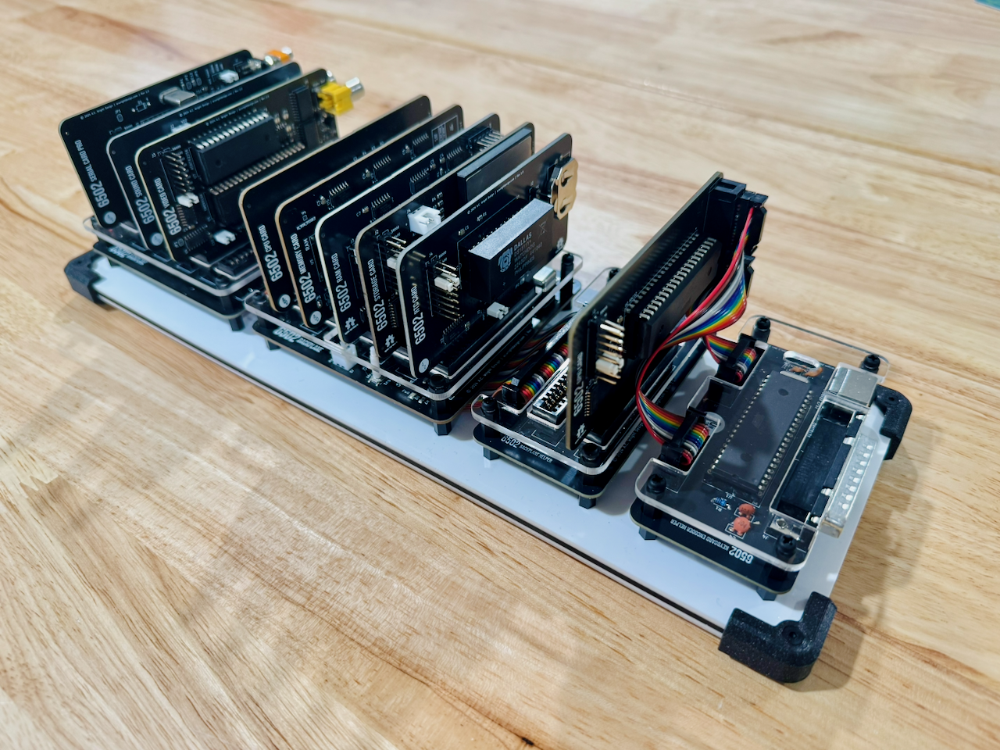

6502-COB
========



An **AC6502** retro-style 8-bit computer based on the **65C02** microprocessor.

> 📖 **Guide:** [AC6502 Documentation](https://acwright.github.io/6502-DOCS/) — the user's and programmer's guide for the whole family.
> See [COB's page in the family appendix](https://acwright.github.io/6502-DOCS/family/cob).

---

**Building one? Every part you need, with supplier numbers and known issues, is in [BOM.md](BOM.md).**

## Table of Contents

- [Overview](#overview)
- [Architecture](#architecture)
- [Systems](#systems)
- [Software](#software)
- [Hardware](#hardware)
  - [Backplanes](#backplanes)
  - [Cards](#cards)
  - [Helpers](#helpers)
- [Which revision to make](#which-revision-to-make)
- [Firmware](#firmware)
  - [KEH Controller](#keh-controller)
  - [PS2 Keyboard Controller](#ps2-keyboard-controller)
  - [STP Controller](#stp-controller)
- [CAD](#cad)
- [Production](#production)
- [Schematics](#schematics)
- [Shared lines](#shared-lines)
- [Extra pins: `EXP0`–`EXP3` and `HRDB`](#extra-pins-exp0exp3-and-hrdb)
- [Jumpers](#jumpers)
- [Off-board headers](#off-board-headers)
- [Checking the schematics](#checking-the-schematics)
- [Libraries](#libraries)
- [Bill of Materials](#bill-of-materials)
- [Purchase](#purchase)
- [License](#license)

---

## Overview

The AC6502 ecosystem is a family of open-source, 65C02-based computers sharing a common architecture, memory map, and [BIOS](https://github.com/acwright/6502-BIOS). Each computer in the family is purpose-built for a different use case but runs the same software and firmware.

The **COB** (Computer on a Backplane) is a full-featured modular desktop computer. It features a real 65C02 CPU, a backplane architecture with expandable card slots, up to 544KB RAM, composite or VGA video output, CompactFlash or SD storage, a real-time clock, and support for PS/2 keyboards, matrix keyboards, and Atari 2600-compatible joysticks.

## Architecture

All AC6502 computers share:

- **CPU**: 65C02 (or accurate emulation)
- **Memory**: 32KB RAM + 32KB ROM, with optional banked RAM expansion
- **Memory Map**: Standardized across the ecosystem — zero page, stack, I/O space ($8000–$9FFF), system ROM, and interrupt vectors at $FFFA–$FFFF
- **Bus**: 16-bit address bus, 8-bit bidirectional data bus, standard 65C02 control signals (RW, PHI2, RESET, IRQ, NMI, RDY, SYNC)
- **BIOS**: A common [BIOS](https://github.com/acwright/6502-BIOS) provides the kernel, monitor, and BASIC interpreter across all systems

## Systems

| Project | Description |
|---------|-------------|
| [6502-ACE](https://github.com/acwright/6502-ACE) | All-in-one Computer Experience — A single board computer |
| [6502-COB](https://github.com/acwright/6502-COB) | Computer On a Backplane — Modular desktop computer with expandable card slots (YOU ARE HERE) |
| [6502-DEV](https://github.com/acwright/6502-DEV) | Development Environment Vehicle — Emulation-based dev system |
| [6502-KIM](https://github.com/acwright/6502-KIM) | Keypad Input Monitor - KIM-1 inspired minimal computer |
| [6502-VCS](https://github.com/acwright/6502-VCS) | Video Computer System — Cartridge-based retro gaming console |

## Software

| Project | Description |
|---------|-------------|
| [6502-BIOS](https://github.com/acwright/6502-BIOS) | The shared BIOS (kernel, monitor, BASIC) for all AC6502 computers |
| [6502-EMULATOR](https://github.com/acwright/6502-EMULATOR) | Emulator for the whole family — desktop app, browser build, and a command line for scripted runs |
| [6502-PRG](https://github.com/acwright/6502-PRG) | Template project for writing assembly language programs |
| [6502-CRT](https://github.com/acwright/6502-CRT) | Template project for writing assembly language cartridges |
| [6502-ASM](https://github.com/acwright/6502-ASM) | Assembly language example programs and demos |
| [6502-BAS](https://github.com/acwright/6502-BAS) | BASIC program listings |
| [6502-WOZMON](https://github.com/acwright/6502-WOZMON) | Wozmon as a standalone ROM |
| [6502-NOP](https://github.com/acwright/6502-NOP) | An all-NOP ROM, for probing a board during bring-up |
| [6502-DOCS](https://github.com/acwright/6502-DOCS) | The documentation site — the guide, the printable reference cards, branding and label artwork |
| [cffs](https://github.com/acwright/cffs) | Builds CompactFlash disk images for the BIOS filesystem |
| [bastok](https://github.com/acwright/bastok) | Tokenizes BASIC listings into `.prg` images, and back |
| [bin2woz](https://github.com/acwright/bin2woz) | Converts a binary into a Wozmon serial upload |

## Hardware

This repository contains KiCad 7.0+ PCB designs for the backplanes, cards, and helpers that make up the COB system.

### Backplanes

**`Hardware/Backplane/`** — Passive backplane providing 5 card slots with full bus interconnect across all slots.

**`Hardware/Backplane Pro/`** — Enhanced backplane with integrated clock generation, reset circuitry, and power distribution plus 5 card slots. Rev 1.1 moves to entirely through-hole components and adds an onboard power switch and DC barrel jack input. Rev 1.2 removes the `RESB` pull-up and adds reverse-polarity protection on the barrel jack. Every revision's oscillator can is 1 MHz, and serial is tested at 1 MHz. A faster can is at the builder's risk, because the serial cards haven't been tested with one.

**`Hardware/Backplane Helper/`** — Adds additional card slots to expand the total backplane configuration up to 12 slots.

### Cards

**`Hardware/Clock Card/`** — The Backplane Pro's clock, reset and power on a card, so a COB can be built on the passive Backplane: a 1 MHz DIP-14 can oscillator to `PHI2` through a clock-enable header (so the Clock Helper's single-step and halt still work), the 555 power-on and push-button reset pulling `RESB` low through an NPN, and a 5 V barrel jack with reverse-polarity protection. Serial is tested at 1 MHz, so a faster oscillator can is at the builder's risk, as on the Backplane Pro. *(Ordered, not yet built)*

**`Hardware/CPU Card/`** — Hosts the 65C02 CPU in a card form factor for backplane-based COB systems. Its `EXP` header, J3, can jumper `EXP0` to VPB and `EXP1` to MLB. Leave those two positions open in a build that takes cartridges, because a cartridge grounds `EXP0` and `EXP1` (see [Extra pins](#extra-pins-exp0exp3-and-hrdb)).

**`Hardware/CPU Card Pro/`** — Hosts a 65816 16-bit CPU (backward-compatible with 65C02). *(Untested)* Its title block credits bahamutkotd, who contributed. Its `EXP` header, J3, can jumper `EXP0` to VPB and `EXP1` to MLB; as on the CPU Card, leave those positions open in a build that takes cartridges.

**`Hardware/Memory Card/`** — Provides 32KB SRAM and 32KB EEPROM with address decoding logic for COB systems using the CPU Card. J2 (or the solder jumpers JP1 and JP2) joins the bus's `EXP1` and `EXP0` to the ROM's `HRDB`: fit both in a COB that takes cartridges. See [Extra pins](#extra-pins-exp0exp3-and-hrdb).

**`Hardware/RAM Card/`** — 512KB banked RAM expansion organized as two 256KB banks with 256 × 1KB windows each.

**`Hardware/RTC Card/`** — Real-time clock via Dallas DS1511Y with battery backup and 256 bytes of battery-backed SRAM.

**`Hardware/GPIO Card/`** — General-purpose I/O via 65C22 VIA supporting keyboards, joysticks, timers, and custom devices.

**`Hardware/Serial Card/`** — RS-232 serial communication via R6551AP ACIA and MAX232 level shifter.
Female DB-9 wired as **DCE**, so a straight-through cable reaches a PC. `DCD` and `DSR` are tied to
ground; `DTR` is not connected. The `CTS EN` jumper (J4) picks whether the ACIA's `CTS` comes from
ground or from the cable — **ground is the default**, which leaves the transmitter always free to
send. Serial is tested at 1 MHz, the speed of the oscillator can on the Backplane Pro and the Clock
Card. A faster can is at the builder's risk.

**`Hardware/Serial Card Pro/`** — Enhanced serial card with full modem control signals (DTR, DCD, DSR).
Male DB-9 wired as **DTE**, like a PC, so reaching a laptop needs a **null-modem** cable — unlike the
plain Serial Card. `CTS`, `DSR` and `DTR` always reach the cable; the `DCD EN` jumper picks ground or
the cable for `DCD` — **ground is the default**. Serial is tested at 1 MHz, the speed of the
oscillator can on the Backplane Pro and the Clock Card. A faster can is at the builder's risk.

**The handshake lines are not decoration.** On a real R6551, measured on a KIM in 2026: `CTS` high
stops the transmitter dead, and `DCD` high stops the receiver and the arriving byte is lost. A card
jumpered to take either from the cable, plugged into something that does not assert them, looks like
a dead board — no banner, no echo — until the line comes back. Ground is the default for exactly
that reason.

**`Hardware/VGA Card/`** — VGA 640×480 video output via Raspberry Pi Pico running [Pico9918](https://github.com/visrealm/pico9918) with TMS9918A-compatible graphics modes.

**`Hardware/VGA Card Pro/`** — Fully programmable VGA output using Pi Pico with custom firmware. *(Untested)*

**`Hardware/Video Card/`** — Composite video output via TMS9918A Video Display Processor with 16KB video RAM.

**`Hardware/Video Card Pro/`** — Enhanced composite video card. *(Never made)*

**`Hardware/Sound Card/`** — 3-voice SID audio output via ARMSID module with RCA line-level output.

**`Hardware/Storage Card/`** — CompactFlash storage interface supporting up to 128GB via IDE-compatible protocol.

**`Hardware/Storage Card Pro/`** — SD card (up to 32GB) and 16MB onboard SPI flash storage interface. *(Untested, experimental — the stock BIOS has no driver for it; see [STP Controller](#stp-controller))*

**`Hardware/LCD Card/`** — 16×2 character LCD display via 65C22 VIA in 4-bit or 8-bit mode.

**`Hardware/Blinkenlights Card/`** — Visual bus monitoring with LEDs showing address bus (16), data bus (8), and control signals (8) in real time.

**`Hardware/Prototype Card/`** — Blank prototyping area with integrated breadboard and full bus access headers.

### Helpers

**`Hardware/Keyboard Encoder Helper/`** — ATmega1284-based dual keyboard encoder supporting PS/2 keyboard and 8×8 matrix keyboard simultaneously via 65C22 VIA.

**`Hardware/PS2 Helper/`** — ATmega328p-based PS/2 keyboard bridge that drives an MT8808 analog crosspoint switch to emulate a matrix keyboard. Its output is a raw 8×8 matrix and feeds the matrix inputs of a Keyboard Encoder Helper, which is what talks to the 65C22 VIA — not the VIA directly.

**`Hardware/Keyboard Helper/`** — 64-key matrix keyboard with Atari 2600-compatible joystick support.

**`Hardware/GPIO Helper/`** — 8 buttons and 8 LEDs for testing and debugging GPIO Card connections.

**`Hardware/GPIO Breadboard Helper/`** — Breadboard interface adapter for the GPIO Card.

**`Hardware/Joystick Helper/`** — Atari 2600-style dual joystick connector and interface board.

**`Hardware/Clock Helper/`** — Manual clock control providing single-step, free-run, and halt modes for debugging real CPU systems.

**`Hardware/DB25 Helper/`** — GPIO to DB25 connector adapter for external device interfacing.

**`Hardware/Breadboard Helper/`** — Exposes the full AC6502 bus to a breadboard for prototyping and experimentation.

**`Hardware/Mega Helper/`** — Arduino Mega 2560 interface adapter for the AC6502 bus. Arduino pins D6 and D5 are wired to `EXP1` and `EXP0`: with a cartridge on the bus, firmware must leave them as inputs, because the cartridge grounds them (see [Extra pins](#extra-pins-exp0exp3-and-hrdb)).

**`Hardware/LCD Board/`** — 320×240 TFT LCD display (ILI9341) interfaced via 65C22 VIA.

**`Hardware/VERA Helper/`** — VERA FPGA video module adapter for the AC6502 bus.

<!-- Which revision to make: generated by Tools/revision-audit/register.py from Tools/data/orders.json. Edit that file, not this section. -->
## Which revision to make

**Make the newest revision of a board, and check its label first.** The table below gives each board's newest revision. A newer revision fixes what was found on the older ones. Every revision, old and new, is in [REVISIONS.md](REVISIONS.md), with what changed in each.

Each revision carries one of three labels:

- **Tested:** This revision was built and tested.
- **Proven design:** Not built at this revision, but its circuit is a tested revision's. The only changes are silkscreen text, part values, mounting holes, outline clean-up, capacitor pitch, socket outlines, a footprint swap with the same holes, a solder jumper's default, or tracks rerouted with DRC and the netlist check passing. A builder can treat it as tested.
- **Untested:** The circuit, the power path or the layout changed in a way that only a built board proves, or the board has never been built at all.

[BOM.md](BOM.md) has the parts for every revision, and its known issues.

| Board | Newest revision | Label | Why |
|---|---|---|---|
| Backplane | 1.0 | **Tested** | Built and tested. |
| Backplane Helper | 1.0 | **Tested** | Built and tested. |
| Backplane Pro | 1.2 | **Untested** | A 1N5819 in the power path (`VCC` near 4.6 V), and R5 removed. |
| Blinkenlights Card | 1.1 | **Untested** | Decoupling capacitors added, with tracks rerouted to reach them. |
| Breadboard Helper | 1.1 | **Proven design** | J1 takes the box header's footprint, with the same holes. |
| CPU Card | 1.1 | **Proven design** | 10k pull-ups, some tracks rerouted, silkscreen. |
| CPU Card Pro | 1.0 | **Untested** | Never made. |
| Clock Card | 1.0 | **Untested** | A new board, ordered and not tested yet. |
| Clock Helper | 1.1 | **Proven design** | Mounting holes moved to the standard, silkscreen. |
| DB25 Helper | 1.1 | **Proven design** | Mounting holes moved to the standard, silkscreen. |
| GPIO Breadboard Helper | 1.0 | **Tested** | Built and tested. |
| GPIO Card | 1.0 | **Tested** | Built and tested. |
| GPIO Helper | 1.1 | **Proven design** | Mounting holes moved to the standard, silkscreen. |
| Joystick Helper | 1.1 | **Proven design** | Mounting holes moved to the standard, silkscreen. |
| Keyboard Encoder Helper | 1.1 | **Proven design** | Mounting holes, silkscreen. |
| Keyboard Helper | 1.0 | **Tested** | Built and tested. |
| LCD Board | 1.0 | **Tested** | Built and tested. |
| LCD Card | 1.1 | **Proven design** | JP1, a solder jumper, ships open, where Rev 1.0's is bridged. |
| Mega Helper | 1.0 | **Tested** | Built and tested. |
| Memory Card | 1.0 | **Tested** | Built and tested. |
| PS2 Helper | 1.1 | **Proven design** | Resistors moved and tracks rerouted, mounting holes, silkscreen. |
| Prototype Card | 1.0 | **Tested** | Built and tested. |
| RAM Card | 1.0 | **Tested** | Built and tested. |
| RTC Card | 1.0 | **Tested** | Built and tested. |
| Serial Card | 1.1 | **Proven design** | Silkscreen text only. |
| Serial Card Pro | 1.1 | **Proven design** | The DB-9 moved to KiCad's standard footprint (the same connector), tracks rerouted, silkscreen. |
| Sound Card | 1.1 | **Proven design** | Silkscreen text only. |
| Storage Card | 1.0 | **Tested** | Built and tested. |
| Storage Card Pro | 1.1 | **Untested** | Silkscreen text only, but Rev 1.0 hasn't been tested. |
| VERA Helper | 1.1 | **Proven design** | Mounting holes, capacitor pitch. |
| VGA Card | 1.1 | **Untested** | The pico9918 turned around, a new outline and jack mount, and A1 wired to `MODE1`. |
| VGA Card Pro | 1.0 | **Untested** | Never made. |
| Video Card | 1.1 | **Proven design** | JP7, a solder jumper, ships bridged (fine with a real TMS9918A's open-drain `/INT`), sockets, silkscreen. |
| Video Card Pro | 1.0 | **Untested** | Never made. |
<!-- End of which revision to make -->

## Firmware

This repository contains [PlatformIO](https://platformio.org/)-based firmware for the COB system's microcontroller helpers.

### KEH Controller
`Firmware/KEH Controller/`

Firmware for the ATmega1284 on the Keyboard Encoder Helper. Provides:

- Simultaneous PS/2 keyboard and 8×8 matrix keyboard scanning
- ASCII conversion with modifier key support (Shift, Ctrl)
- Buffered, debounced input handling
- Parallel I/O to the AC6502 bus via 65C22 VIA

See [Firmware/KEH Controller/README.md](./Firmware/KEH%20Controller/README.md) for setup and usage instructions.

### PS2 Keyboard Controller
`Firmware/PS2 Keyboard Controller/`

Firmware for the ATmega328p on the PS2 Helper. Provides:

- Interrupt-driven PS/2 keyboard scan code reading
- MT8808 analog crosspoint switch matrix control
- Make/break detection and extended scan code support
- Function key emulation via FN key combinations

The MT8808 closes row/column contacts in place of physical key switches, so this
card connects to the **matrix inputs of a Keyboard Encoder Helper**, not to a
65C22 VIA. The encoder does the scanning and ASCII conversion; wired straight to
a VIA the card produces nothing, as the BIOS has no matrix-scanning code.

See [Firmware/PS2 Keyboard Controller/README.md](./Firmware/PS2%20Keyboard%20Controller/README.md) for setup and usage instructions.

### STP Controller
`Firmware/STP Controller/`

Firmware for the ATmega328p on the Storage Card Pro. Provides:

- Memory-mapped SPI controller for 6502 bus access
- Support for SD card, 16MB SPI flash, and external SPI devices
- Dual-speed SPI (4 MHz normal operation, 400 kHz initialization)
- PHI2-synchronized interface for reliable 6502 communication

⚠️ **Experimental.** The Storage Card Pro is not part of the default I/O set the
BIOS probes for, and no COB machine is built around it today. The BIOS storage
slot expects eight True IDE CompactFlash registers at `$8C00–$8C07`; this card
presents two SPI registers instead, so a stock BIOS reports `NO DEVICE` for every
storage path. Using it needs a modified BIOS or software that drives the two
registers directly.

See [Firmware/STP Controller/README.md](./Firmware/STP%20Controller/README.md) for setup and usage instructions.

## CAD
`CAD/`

3D-printable enclosure parts and laser-cut top panels for the COB system.

**Board images** are in `CAD/Images/<Board>/Rev X/`: `Front.png` and `Back.png` on white, and `Front Transparent.png` and `Back Transparent.png` with no background. Every image is a 3D render at the same size, with the black solder mask and white silkscreen the boards are made with. Bare-board photos may differ, because the renders show parts fitted.

**Top panels, enclosures and jigs are versioned by board revision**, like `Hardware/`: `CAD/Tops/<Board>/Rev X/`, `CAD/Enclosures/<Board>/Rev X/`, `CAD/Jigs/<Board>/Rev X/`. Each revision has its own complete folder, even when two revisions share the same files. `Bases/` holds the parts for a whole computer, not for one board, so it isn't versioned.

Keyboard Encoder Helper Rev 1.0, the board on sale, has the old 88 × 39 mm holes, and the COB's base plate is drilled for Rev 1.1's 88 × 38 mm. To fit a Rev 1.0 board, drill plate holes 9 and 21 (x 296, at y 16 and y 104 on the plate mounting drawing) out to 5 mm. The two screws then sit 1 mm to the left of those holes' centers, and the board moves less than 1 mm into the 10 mm gap beside the Backplane Helper. Drill through all three layers of the plate, and add a washer if a screw head doesn't sit flat. The plate mounting drawing itself shows Rev 1.1.

The Rev 1.0 top panels for the Clock, DB25, GPIO, Joystick and Keyboard Encoder Helpers, and the Rev 1.1 top panel for the PS2 Helper, are derived from the other revision's panel by moving the four mounting holes. None of them has been cut yet.

The **[plate mounting drawing](CAD/Bases/Plate%20Mounting%20Drawing.png)** ([SVG](CAD/Bases/Plate%20Mounting%20Drawing.svg)) shows where the two Backplanes (each a Backplane or a Backplane Pro), the Backplane Helper and the Keyboard Encoder Helper mount on the base plate, with every hole's position and the hardware the build needs. The plate is a stack of three 3 mm acrylic layers.

## Production
`Production/`

[REVISIONS.md](REVISIONS.md) lists every board revision: whether it was made, its JLCPCB order, the commit it was made from, and what fits it.

JLCPCB-ready Gerber files and BOM/CPL for PCB fabrication and assembly.

## Schematics
`Schematics/`

PDF schematics for each board.

## Shared lines

Five lines of the 6502 bus are shared by every board on it: `RESB`, `IRQB`, `NMIB`, `RDY` and `BE`. A board may pull one of these lines low, and nothing drives one high. Each line is held high by one 10kΩ pull-up resistor to VCC, on the board with the CPU: the ACE Board, the KIM Board, the VCS Main Board, the COB CPU Card or CPU Card Pro, or the DEV Board. No other board has one. Two pull-ups on the same line would sit in parallel and lower its resistance, so a card that adds its own pull-up changes the machine for every other board. The VIAs and PIAs in the BOMs, the W65C22N and W65C21N, have open-drain interrupt outputs for this reason. A W65C22S drives `IRQB` high as well as low, so it can't share the line without a diode.

The same holds where a board has its own reset circuit. A reset switch, its timer and the transistor that pulls `RESB` low can be on any board, such as the COB Backplane Pro or the Clock Card, but the `RESB` pull-up is only ever on the board with the CPU. Each of those boards draws its pull-ups together, in one group on its schematic.

`SOB` is a CPU pin that isn't on the bus. It is tied to VCC, directly or through a 10kΩ resistor.

A few chips have a pull-up of their own inside the chip, such as an ATmega's reset pin. Where such a pin is wired to `RESB`, its pull-up of 30–60kΩ sits in parallel with the 10kΩ one. That's harmless, because whatever pulls `RESB` low can sink the extra current many times over.

A revision that doesn't follow this yet says so in its known issues in [BOM.md](BOM.md), with what to fit or remove.

## Extra pins: `EXP0`–`EXP3` and `HRDB`

`EXP` stands for "extra pin". Four pins of the 6502 bus are left for a builder's own use: pin 4 is `EXP1`, pin 6 is `EXP0`, pin 19 is `EXP3` and pin 21 is `EXP2`.

Pins 4 and 6 have a second job. A cartridge ties both of them to GND. That pulls `HRDB` ("High ROM disable bar", active low) low on the board with the ROM, which takes `$C000–$FFFF` away from the ROM so that the cartridge answers there instead. So in a build that uses cartridges, pins 4 and 6 are reserved for `HRDB`, and nothing else may drive them. They are free as `EXP1` and `EXP0` only in a build that never uses cartridges. `EXP2` and `EXP3` are always free.

How the boards treat pins 4 and 6:

- **The ACE Board and the KIM Board** join them to their ROM's `HRDB` input, and their silk says `HRDB`. The VCS Main Board joins them the same way from Rev 1.1.
- **The COB Memory Card** joins them to its `HRDB` only through jumpers: fit two shunts on J2, or bridge JP1 and JP2, in a COB that takes cartridges. It is the only board with these jumpers, because the COB is the experimenter's build. The VCS Main Board Rev 1.0 had them too (J5, or JP3 and JP4); fit them, because the VCS always takes cartridges.
- **A cartridge** (the ROM Cart, the Flash Cart, the KIM Keypad Card) ties them to GND.
- **A board that only carries the bus through**, such as a backplane or a helper, calls them `EXP1` and `EXP0`, as its silk does, and a note on its schematic says what they carry.

<!-- Jumpers: generated by Tools/jumpers/gen.py from Tools/data/jumpers.json. Edit that file, not this section. -->
## Jumpers

Some boards have solder jumpers, and pin headers that take a shunt. The tables below give every one: what it's for, how the board is shipped, and what to do with it. The **Needed** column marks the ones that matter:

- **To run**: the board doesn't work until this is set. Set it before the first power-up.
- **For serial**, **For interrupts**, **For cartridges**: the board runs without it, but that feature doesn't.
- Blank: leave it as shipped unless you want what it offers.

Where a header needs a shunt, the board's BOM lists it.

**Backplane Pro**

| Rev | Jumper | What it's for | As shipped | What to do | Needed |
|---|---|---|---|---|---|
| 1.0 | JP1, J1 | Power: JP1 is across J1 (`PWR_SW`), the header for a power switch on a case. | Open. | Bridge JP1, or wire a switch to J1. Until one is done the backplane has no power. | To run |
| 1.0 | JP2, J4 | Clock: JP2 is across J4 (`CLOCK_ENBL_SW`), the header for a switch that stops the clock. | Open. | Bridge JP2, or wire a switch to J4. Until one is done there is no clock on `PHI2`. | To run |
| 1.1, 1.2 | JP1, J5 | Clock: JP1 is across J5 (`CLOCK ENBL SW`), the header for a switch that stops the clock. | Open. | Bridge JP1, or wire a switch to J5. Until one is done there is no clock on `PHI2`. | To run |

**CPU Card**

| Rev | Jumper | What it's for | As shipped | What to do | Needed |
|---|---|---|---|---|---|
| 1.0, 1.1 | J3 | `EXP`: shunts here join CPU signals (`VPB`, `MLB`, `SOB`, `PHI1O`, `PHI2O`) to the bus's extra pins. | No shunts. | Leave it empty unless a project needs one. Never join `EXP0` or `EXP1` in a build that uses cartridges (see *Extra pins*). |  |
| 1.0, 1.1 | JP1, J2 | Original 6502: grounds pin 1, which is `VSS` on an NMOS 6502 and `VPB` on a 65C02. | Open, no shunt. | Leave both open for a 65C02. Bridge JP1, or fit a shunt on J2, only for an original 6502. |  |

**CPU Card Pro**

| Rev | Jumper | What it's for | As shipped | What to do | Needed |
|---|---|---|---|---|---|
| 1.0 | J3 | `EXP`: shunts here join 65816 signals (`VPB`, `MLB`, `MX`, `E`) to the bus's extra pins. | No shunts. | Leave it empty unless a project needs one. Never join `EXP0` or `EXP1` in a build that uses cartridges (see *Extra pins*). |  |

**Clock Card**

| Rev | Jumper | What it's for | As shipped | What to do | Needed |
|---|---|---|---|---|---|
| 1.0 | JP1, J3 | Clock: JP1 is across J3 (`CLOCK ENBL SW`), the header for a switch that stops the clock. | Open. | Bridge JP1, or wire a switch to J3. Until one is done there is no clock on `PHI2`. | To run |

**GPIO Card**

| Rev | Jumper | What it's for | As shipped | What to do | Needed |
|---|---|---|---|---|---|
| 1.0 | J2 | I/O window: one shunt picks the 1 KB window the board answers in. | No shunt. | Fit the shunt beside `$9400`: IO 6, where the BIOS looks for the GPIO Card. | To run |
| 1.0 | JP1 | Bridged across D1, the diode in the VIA's interrupt line. | Bridged. | Leave it. The VIA's interrupt output only pulls low, so D1 isn't needed. Cut JP1 only for a part that drives its interrupt high as well as low. |  |

**LCD Board**

| Rev | Jumper | What it's for | As shipped | What to do | Needed |
|---|---|---|---|---|---|
| 1.0 | J2 | I/O window: one shunt picks the 1 KB window the board answers in. | No shunt. | Fit the shunt beside a window no other card uses. The BIOS doesn't look for this board. | To run |
| 1.0 | JP1 | Bridged across D2, the diode in the VIA's interrupt line. | Bridged. | Leave it. The VIA's interrupt output only pulls low, so D2 isn't needed. Cut JP1 only for a part that drives its interrupt high as well as low. |  |

**LCD Card**

| Rev | Jumper | What it's for | As shipped | What to do | Needed |
|---|---|---|---|---|---|
| 1.0, 1.1 | J3 | I/O window: one shunt picks the 1 KB window the board answers in. | No shunt. | Fit the shunt beside a window no other card uses. The BIOS doesn't look for this board. | To run |
| 1.0 | JP1 | Bridged across D1, the diode in the VIA's interrupt line. | Bridged. | Leave it. The VIA's interrupt output only pulls low, so D1 isn't needed. Cut JP1 only for a part that drives its interrupt high as well as low. |  |
| 1.1 | JP1 | Across D1, the diode in the VIA's interrupt line. | Open. | Leave it. The interrupt reaches `IRQB` through D1, which works with or without the jumper. |  |

**Memory Card**

| Rev | Jumper | What it's for | As shipped | What to do | Needed |
|---|---|---|---|---|---|
| 1.0 | J2, JP1, JP2 | `HRDB`: joins the bus's `EXP1` and `EXP0` to the ROM's High ROM disable, so a cartridge can take `$C000–$FFFF`. | Open, no shunts. | Fit two shunts on J2, or bridge JP1 and JP2, in a COB that takes cartridges. Leave them open to keep `EXP0` and `EXP1` free (see *Extra pins*). |  |
| 1.0 | J3, JP3 | ROM write: joins the ROM's `/WE` to the bus's write strobe, so a program can write the EEPROM in circuit. | Open, no shunt. | Leave it open: R2 holds `/WE` high, and the ROM can't be overwritten by mistake. Fit a shunt on J3, or bridge JP3, only to write the ROM in circuit. |  |

**RAM Card**

| Rev | Jumper | What it's for | As shipped | What to do | Needed |
|---|---|---|---|---|---|
| 1.0 | J3 | I/O windows: two shunts pick the two 1 KB windows the banks answer in. | No shunts. | Fit one shunt beside `$8000` (IO 1) and one beside `$8400` (IO 2), where the BIOS looks for the RAM Card. R1 and R2 pull the selects low, so a window left without its shunt answers at every address. | To run |
| 1.0 | JP1, J2 | `LATCH EN`: JP1 holds the bank latch's outputs on; J2 is for a switch in its place. | JP1 bridged. | Leave it. To switch the latch off with J2, cut JP1 first. |  |

**RTC Card**

| Rev | Jumper | What it's for | As shipped | What to do | Needed |
|---|---|---|---|---|---|
| 1.0 | J3 | Interrupt: one shunt sends the board's interrupt to `IRQB` or `NMIB`. | No shunt. | Fit the shunt on `IRQB`, which the BIOS expects. With no shunt the interrupt reaches neither. | For interrupts |
| 1.0 | J4 | I/O window: one shunt picks the 1 KB window the board answers in. | No shunt. | Fit the shunt beside `$8800`: IO 3, where the BIOS looks for the RTC Card. | To run |
| 1.0 | JP1 | Bridged across D1, the diode in the DS1511Y's interrupt line. | Bridged. | Leave it. The DS1511Y's interrupt output only pulls low, so D1 isn't needed. Cut JP1 only for a part that drives its interrupt high as well as low. |  |
| 1.0 | JP3, JP2 | JP3 feeds `PHI2` to an enable of U3, a 74HC138, so the board is selected only while `PHI2` is high. JP2 would tie that enable high instead. | JP3 bridged, JP2 open. | Leave them. |  |

**Serial Card**

| Rev | Jumper | What it's for | As shipped | What to do | Needed |
|---|---|---|---|---|---|
| 1.0, 1.1 | J3 | I/O window: one shunt picks the 1 KB window the board answers in. | No shunt. | Fit the shunt beside `$9000`: IO 5, where the BIOS looks for the Serial Card. | To run |
| 1.0, 1.1 | J4 | `CTS`: where the ACIA's `CTS` comes from. | No shunt. | Fit the shunt on pins 2 and 3, ground, as the boards are built. On pins 1 and 2 it takes `CTS` from the cable, and a cable that doesn't assert it stops the transmitter. With no shunt the input floats, and serial may not work. | For serial |
| 1.0, 1.1 | JP1 | Bridged across D1, the diode in the ACIA's interrupt line. | Bridged. | Leave it. The ACIA's interrupt output only pulls low, so D1 isn't needed. Cut JP1 only for a part that drives its interrupt high as well as low. |  |
| 1.0, 1.1 | JP2, JP3 | Options for the ACIA's crystal: JP2 adds R1 (1M) across it, and JP3 adds C7 (22pF) to ground. | Both open. | Leave them open: the tested cards run without them. |  |

**Serial Card Pro**

| Rev | Jumper | What it's for | As shipped | What to do | Needed |
|---|---|---|---|---|---|
| 1.0, 1.1 | J3 | I/O window: one shunt picks the 1 KB window the board answers in. | No shunt. | Fit the shunt beside `$9000`: IO 5, where the BIOS looks for the Serial Card Pro. | To run |
| 1.0, 1.1 | J4 | `DCD`: where the ACIA's `DCD` comes from. | No shunt. | Fit the shunt on pins 1 and 2, ground, as the boards are built. On pins 2 and 3 it takes `DCD` from the cable, and a cable that doesn't assert it stops the receiver. With no shunt the input floats, and serial may not work. | For serial |
| 1.0, 1.1 | JP1 | Bridged across D1, the diode in the ACIA's interrupt line. | Bridged. | Leave it. The ACIA's interrupt output only pulls low, so D1 isn't needed. Cut JP1 only for a part that drives its interrupt high as well as low. |  |
| 1.0, 1.1 | JP2, JP3 | Options for the ACIA's crystal: JP2 adds R1 (1M) across it, and JP3 adds C12 (22pF) to ground. | Both open. | Leave them open: the tested cards run without them. |  |

**Sound Card**

| Rev | Jumper | What it's for | As shipped | What to do | Needed |
|---|---|---|---|---|---|
| 1.0, 1.1 | J5 | I/O window: one shunt picks the 1 KB window the board answers in. | No shunt. | Fit the shunt beside `$9800`: IO 7, where the BIOS looks for the Sound Card. | To run |

**Storage Card**

| Rev | Jumper | What it's for | As shipped | What to do | Needed |
|---|---|---|---|---|---|
| 1.0 | J2 | I/O window: one shunt picks the 1 KB window the board answers in. | No shunt. | Fit the shunt beside `$8C00`: IO 4, where the BIOS looks for the Storage Card. | To run |

**Storage Card Pro**

| Rev | Jumper | What it's for | As shipped | What to do | Needed |
|---|---|---|---|---|---|
| 1.0, 1.1 | J5 | I/O window: one shunt picks the 1 KB window the board answers in. | No shunt. | Fit the shunt beside `$8C00`: IO 4, where the BIOS looks for the Storage Card Pro. The BIOS doesn't support this card yet. | To run |

**VERA Helper**

| Rev | Jumper | What it's for | As shipped | What to do | Needed |
|---|---|---|---|---|---|
| 1.0, 1.1 | J5 | Interrupt: one shunt sends the board's interrupt to `IRQB` or `NMIB`. | No shunt. | Fit the shunt on `IRQB` or `NMIB`, as your program needs. `IRQB` is the usual choice; the BIOS doesn't use this interrupt. With no shunt the interrupt reaches neither. | For interrupts |
| 1.0, 1.1 | J6 | I/O window: one shunt picks the 1 KB window the board answers in. | No shunt. | Fit the shunt beside a window no other card uses. The BIOS doesn't look for this board. | To run |
| 1.0, 1.1 | JP2 | Bridged across D1, the diode in the VERA module's interrupt line. | Bridged. | Leave it as shipped. Cut JP2 if the module drives its interrupt high as well as low, so D1 stays in the line. |  |
| 1.0, 1.1 | JP3, JP1 | JP3 feeds `PHI2` to an enable of U2, a 74HC138, so the board is selected only while `PHI2` is high. JP1 would tie that enable high instead. | JP3 bridged, JP1 open. | Leave them. |  |

**VGA Card**

| Rev | Jumper | What it's for | As shipped | What to do | Needed |
|---|---|---|---|---|---|
| 1.0, 1.1 | J2 | Interrupt: one shunt sends the board's interrupt to `IRQB` or `NMIB`. | No shunt. | Fit the shunt on `IRQB`, which the BIOS expects. With no shunt the interrupt reaches neither. | For interrupts |
| 1.0, 1.1 | J3 | I/O window: one shunt picks the 1 KB window the board answers in. | No shunt. | Fit the shunt beside `$9C00`: IO 8, where the BIOS looks for the VGA Card. | To run |
| 1.0 | JP1 | Across D1, the diode in the pico9918's interrupt line. | Bridged. | Cut JP1. The pico9918 drives its interrupt high as well as low, and only D1 stops it holding `IRQB` high against every other card. | For interrupts |
| 1.0, 1.1 | JP3, JP2 | JP3 feeds `PHI2` to an enable of U3, a 74HC138, so the board is selected only while `PHI2` is high. JP2 would tie that enable high instead. | JP3 bridged, JP2 open. | Leave them. |  |
| 1.1 | JP1 | Across D1, the diode in the pico9918's interrupt line. | Open. | Leave it open: the pico9918 drives its interrupt high as well as low, and D1 lets it only pull `IRQB` low. Never bridge it. |  |

**VGA Card Pro**

| Rev | Jumper | What it's for | As shipped | What to do | Needed |
|---|---|---|---|---|---|
| 1.0 | J3 | Interrupt: one shunt sends the board's interrupt to `IRQB` or `NMIB`. | No shunt. | Fit the shunt on `IRQB`, which the BIOS expects. With no shunt the interrupt reaches neither. | For interrupts |
| 1.0 | J4 | I/O window: one shunt picks the 1 KB window the board answers in. | No shunt. | Fit the shunt beside `$9C00`: IO 8, where the BIOS looks for the VGA Card Pro. | To run |
| 1.0 | JP1 | Adds R1, a 1k pull-up, to the 5 V side of the interrupt's level shifter (Q1). | Open. | Leave it open: the CPU board's 10k pull-up on `IRQB` does that job, and two pull-ups would sit in parallel (see *Shared lines*). |  |
| 1.0 | JP2 | Bridged across D1, the diode in the level shifter's interrupt line. | Bridged. | Leave it. The level shifter's interrupt output only pulls low, so D1 isn't needed. Cut JP2 only for a part that drives its interrupt high as well as low. |  |
| 1.0 | JP4, JP3 | JP4 feeds `PHI2` to an enable of U5, a 74LVC138, so the board is selected only while `PHI2` is high. JP3 would tie that enable high instead. | JP4 bridged, JP3 open. | Leave them. |  |

**Video Card**

| Rev | Jumper | What it's for | As shipped | What to do | Needed |
|---|---|---|---|---|---|
| 1.0, 1.1 | J1 | Interrupt: one shunt sends the board's interrupt to `IRQB` or `NMIB`. | No shunt. | Fit the shunt on `IRQB`, which the BIOS expects. With no shunt the interrupt reaches neither. | For interrupts |
| 1.0, 1.1 | J3 | I/O window: one shunt picks the 1 KB window the board answers in. | No shunt. | Fit the shunt beside `$9C00`: IO 8, where the BIOS looks for the Video Card. | To run |
| 1.0, 1.1 | JP1, JP2 | JP1 feeds `PHI2` to an enable of U4, a 74HC138, so the board is selected only while `PHI2` is high. JP2 would tie that enable high instead. | JP1 bridged, JP2 open. | Leave them. |  |
| 1.0, 1.1 | JP3, JP4, JP5, JP6 | Video RAM timing: which clock the column latch (U6) takes from U8, a 74HCT04. As shipped it is `/CAS` through three inverters; cut JP4 and JP6 and bridge JP3 and JP5 for one inverter, with less delay. | JP4 and JP6 bridged, JP3 and JP5 open. | Leave them. The tested cards run as shipped. |  |
| 1.0 | JP7 | Bridged across D1, the diode in the TMS9918A's interrupt line. | Open. | Leave it open, so D1 stays in the line. |  |
| 1.1 | JP7 | Bridged across D1, the diode in the TMS9918A's interrupt line. | Bridged. | Leave it. The TMS9918A's interrupt output only pulls low, so D1 isn't needed. Cut JP7 only for a part that drives its interrupt high as well as low. |  |

**Video Card Pro**

| Rev | Jumper | What it's for | As shipped | What to do | Needed |
|---|---|---|---|---|---|
| 1.0 | J3 | Interrupt: one shunt sends the board's interrupt to `IRQB` or `NMIB`. | No shunt. | Fit the shunt on `IRQB`, which the BIOS expects. With no shunt the interrupt reaches neither. | For interrupts |
| 1.0 | J5 | I/O window: one shunt picks the 1 KB window the board answers in. | No shunt. | Fit the shunt beside `$9C00`: IO 8, where the BIOS looks for the Video Card Pro. | To run |
| 1.0 | JP1 | Bridged across D1, the diode in the ATmega1284's interrupt line. | Bridged. | Leave it only if the ATmega's firmware drives its interrupt open-drain, low or released. If the firmware drives it high, cut JP1 so D1 stays in the line. |  |

<!-- End of jumpers -->

<!-- Off-board headers: generated by Tools/offboard/gen.py from Tools/offboard/offboard.json, Tools/data/offboard.json and the PCB files. Edit those, not this section. -->
## Off-board headers

Some boards have small headers, such as `RESET SW`, `CLOCK ENBL SW`, `POWER LED` and `VCC`, that a standard build leaves empty. They are for a machine built into a full enclosure, which AC6502 doesn't offer today. In such a build, the parts a person handles are mounted on the case and wired to the board through these headers: the power jack, the switches, the LEDs and the keyboard. The matching parts on the board are then left off. For example, an ACE Board can sit inside a case with its power jack, power switch and key switches left off, and a Keyboard Helper as its keyboard.

To build a board for a case:

1. Fit the header, and wire the part on the case to it. The table says what goes on each pin.
2. Leave off the parts on the board that the table names. A button on the case can work beside the board's own button, but some parts, such as an LED that shares the board's resistor, can't share.
3. Set any jumper the table mentions. The [Jumpers](#jumpers) section has the rest.

The connector follows the kind of build. A single-board machine, the ACE Board or the KIM Board, uses plain 2.54 mm pin headers, which are simpler and cheaper. A board in a multi-board machine, every COB board and the separate boards of the VCS, the DEV and the KIM, uses JST XH, the family's standard for these headers.

The table lists every off-board header on each board's newest revision, read from the board's PCB file.

| Board | Rev | Header | Label | Connector | What it's for | Leave off |
|---|---|---|---|---|---|---|
| Backplane Pro | 1.2 | J5 | `CLOCK ENBL SW` | JST XH, 2 pins | A switch on the case that stops the clock: closed, the oscillator drives `PHI2`; open, the clock stops. The header is wired across JP1, a solder jumper. | Nothing, but leave JP1 open, or the switch can't stop the clock (see [Jumpers](#jumpers)). |
| Backplane Pro | 1.2 | J6 | `RESET SW` | JST XH, 2 pins | A reset button on the case. The header is wired across SW2, the board's own reset button. | SW2, if the case covers it. Both buttons reset the machine if it stays. |
| Clock Card | 1.0 | J3 | `CLOCK ENBL SW` | JST XH, 2 pins | A switch on the case that stops the clock: closed, the oscillator drives `PHI2`; open, the clock stops. The header is wired across JP1, a solder jumper. | Nothing, but leave JP1 open, or the switch can't stop the clock (see [Jumpers](#jumpers)). |
| Clock Card | 1.0 | J4 | `RESET SW` | JST XH, 2 pins | A reset button on the case. The header is wired across SW1, the board's own reset button. | SW1, if the case covers it. Both buttons reset the machine if it stays. |
| Storage Card | 1.0 | J4 | `ACT LED` | JST XH, 2 pins | An activity LED on the case: anode to pin 1, cathode to pin 2, which runs through R6, the LED's own resistor. | Nothing. D1, the board's own activity LED, has its own resistor, so both light. |
| Storage Card Pro | 1.1 | J1 | `ACT LED` | JST XH, 2 pins | An activity LED on the case: anode to pin 1, cathode to pin 2, which runs through R2, the LED's own resistor. | Nothing. D1, the board's own activity LED, has its own resistor, so both light. |

<!-- End of off-board headers -->

## Checking the schematics
`Tests/check-schematics.mjs`

The RAM Card's bank latch decides which kilobyte of its 512 KB each window shows, and a latch that loads on the wrong address corrupts a bank without any sign. The ACE's equivalent latch was wrong twice while its gates looked right on paper, so this script checks the logic instead of reading it. It asks KiCad for the card's netlist, builds the glue logic from the gates it finds there, fits the card's jumpers, and drives every address, as a read and as a write, with PHI2 high and low. That is 262,144 bus states. For each one it compares the RAM's chip select, read and write strobes and A18, and the latch enable, against the memory map, and checks that the card drives the data bus only on a read of its own window. A net that nothing drives counts as a failure, so a missing wire fails too.

It checks the RAM Card Rev 1.0 with both windows jumpered, IO 1 (`$8000`) and IO 2 (`$8400`), which is the only setting Rev 1.0 supports: R1 and R2 pull the window selects to ground, so a window left without a jumper is selected at every address.

Run it after any change to a checked schematic:

```sh
node Tests/check-schematics.mjs
```

It needs Node.js and KiCad's `kicad-cli`, which it finds on the `PATH`, at the macOS default location, or through a `KICAD_CLI` environment variable. It takes a few seconds, prints `ok` or `FAIL` for each check with example bus states for any failure, and exits non-zero on a failure.

## Libraries
`Libraries/`

Shared KiCad symbol and footprint libraries used across all AC6502 hardware projects, with their 3D models in `Models/`. A part is named for what it is and its shape, such as `RJ45 Jack LED` or `CR2032 Holder`, never for a manufacturer's part number, so a replacement part with the same footprint fits without renaming anything. The part numbers to buy are in [BOM.md](BOM.md). Every AC6502 repository carries the same copy of each part.

## Bill of Materials

Every part for every board, by revision, is in **[BOM.md](BOM.md)**, with supplier numbers, known issues, build notes and files to upload to Digi-Key and Mouser. What changed in each revision, and what is known about each one, is in **[REVISIONS.md](REVISIONS.md)**.

## Purchase

I have a few PCBs available on Tindie for those interested in building their own AC6502 system without ordering from a fab directly.

<a href="https://www.tindie.com/stores/acwrightdesign/?ref=offsite_badges&utm_source=sellers_acwrightdesign&utm_medium=badges&utm_campaign=badge_medium"></a>

## License

Hardware designs are released under the [CERN Open Hardware Licence Version 2 – Permissive](https://ohwr.org/cern_ohl_p_v2.txt).  
Firmware is released under the MIT License — [KEH Controller](./Firmware/KEH%20Controller/LICENSE), [PS2 Keyboard Controller](./Firmware/PS2%20Keyboard%20Controller/LICENSE), [STP Controller](./Firmware/STP%20Controller/LICENSE).
